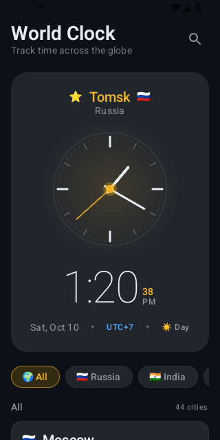
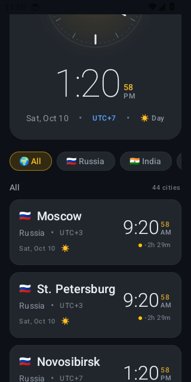
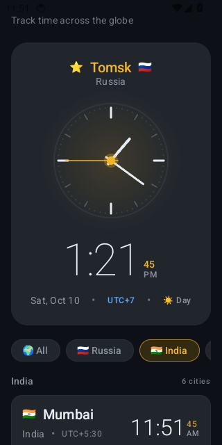
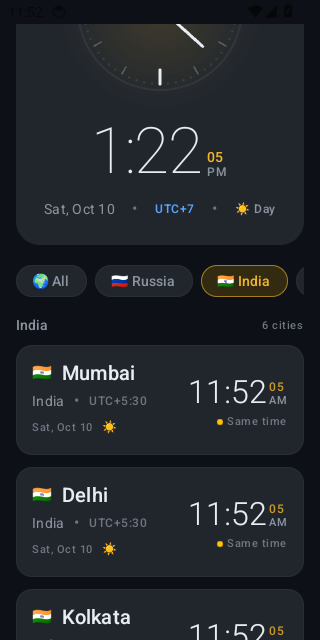
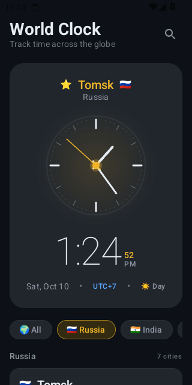
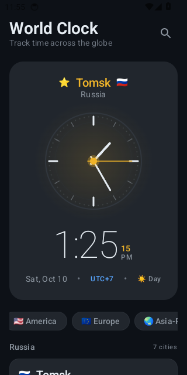
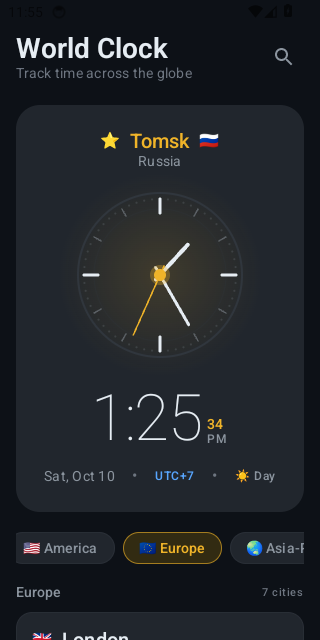
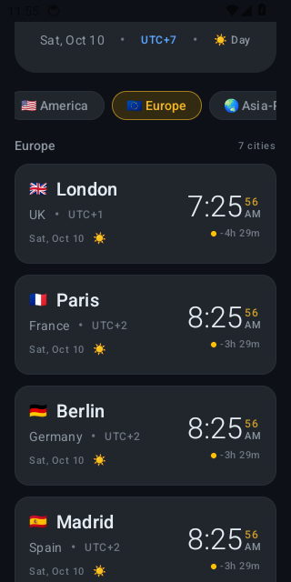

# 🌍 World Clock Android App

A sleek, modern Android application crafted with **Jetpack Compose**, **Material Design 3**, and **AndroidX Glance Widget**. It provides real-time time tracking across all major global time zones with a dynamic hero analog clock, fluid spring physics, regional filtering, and 120Hz high-refresh-rate display support.

---

## 📸 Real App Screenshots

<div align="center">
  <table>
    <tr>
      <td align="center"><b>Featured Hero Clock & Dashboard</b></td>
      <td align="center"><b>Live City Cards & Time Differences</b></td>
    </tr>
    <tr>
      <td></td>
      <td></td>
    </tr>
    <tr>
      <td align="center"><b>Region Filter: India (IST)</b></td>
      <td align="center"><b>Indian Cities & Time Offsets</b></td>
    </tr>
    <tr>
      <td></td>
      <td></td>
    </tr>
    <tr>
      <td align="center"><b>Region Filter: Russia</b></td>
      <td align="center"><b>Horizontal Region Chip Bar</b></td>
    </tr>
    <tr>
      <td></td>
      <td></td>
    </tr>
    <tr>
      <td align="center"><b>Region Filter: Europe</b></td>
      <td align="center"><b>European Metropolises</b></td>
    </tr>
    <tr>
      <td></td>
      <td></td>
    </tr>
  </table>
</div>

---

## ✨ Features

- **⭐ Featured Hero Analog Clock**:
  - Precision canvas-drawn analog clock with ticking second hand, hour markers, and smooth rotation.
  - Live digital time badge with AM/PM indicators and active seconds.
  - Contextual day / night indicators (☀️ / 🌙) and formatted date strings.
  
- **🗺️ Global Coverage (44+ Curated Cities)**:
  - Multi-region support covering **Russia**, **India**, **Europe**, **Americas**, **Asia-Pacific**, and **Oceania**.
  - Accurate UTC offsets and dynamic relative time comparisons (e.g., `-2h 29m`, `Same time`).

- **🏷️ Instant Region Filtering**:
  - Horizontal chip selector with micro-interactions and active highlight rings.
  - Instant list filtering with spring animation physics.

- **🔍 Interactive Search**:
  - Search by city name, country name, or geographic region.

- **⚡ 120Hz Display Optimization**:
  - Programmatic high-refresh-rate configuration (`enableHighRefreshRate()`) ensuring buttery-smooth 90Hz/120Hz scroll and hand animations.

- **📱 Home Screen Glance Widget**:
  - Native Android app widget powered by `androidx.glance:glance-appwidget` and `glance-material3` for glancing at world time from your device home screen.

---

## 🛠️ Architecture & Tech Stack

- **UI Framework**: [Jetpack Compose](https://developer.android.com/jetpack/compose) (BOM `2026.03.01`)
- **Design System**: [Material Design 3](https://m3.material.io/)
- **Widget**: [AndroidX Glance](https://developer.android.com/jetpack/androidx/releases/glance) (`1.1.1`)
- **Navigation**: [AndroidX Navigation 3](https://developer.android.com/guide/navigation) (`1.0.1`)
- **Language**: Kotlin 2.3+
- **Architecture**: MVVM with `StateFlow` and unidirectional data flow (UDF)
- **Time Engine**: `java.time.ZonedDateTime` & `ZoneId` for accurate DST handling
- **Build System**: Gradle 9.1 with Kotlin DSL (`build.gradle.kts`) and Version Catalog (`libs.versions.toml`)

---

## 📁 Project Structure

```text
world-clock-app/
├── app/
│   ├── src/
│   │   ├── main/
│   │   │   ├── java/com/example/worldclock/
│   │   │   │   ├── MainActivity.kt               # Entry point with 120Hz display optimization
│   │   │   │   ├── Navigation.kt                 # Navigation3 route configuration
│   │   │   │   ├── data/
│   │   │   │   │   ├── CityData.kt               # Repository with global city dataset
│   │   │   │   │   └── TimeProvider.kt           # Real-time state provider & ticker flow
│   │   │   │   ├── theme/
│   │   │   │   │   ├── Color.kt                  # Curated dark palette (Amber, Teal, Navy)
│   │   │   │   │   ├── Theme.kt                  # Material 3 dark color scheme
│   │   │   │   │   └── Type.kt                   # Modern typography styles
│   │   │   │   ├── ui/
│   │   │   │   │   ├── components/
│   │   │   │   │   │   ├── AnalogClock.kt        # Canvas-rendered ticking clock
│   │   │   │   │   │   ├── ClockCard.kt          # City card with digital & analog specs
│   │   │   │   │   │   ├── RegionSelector.kt     # Horizontal scrollable chips
│   │   │   │   │   │   └── BouncyModifiers.kt    # Spring click physics
│   │   │   │   │   └── main/
│   │   │   │   │       ├── MainScreen.kt         # Primary dashboard & search UI
│   │   │   │   │       └── MainScreenViewModel.kt# ViewModel managing UI state
│   │   │   │   └── widget/
│   │   │   │       └── WorldClockWidget.kt       # Glance app widget implementation
│   │   │   ├── res/                              # Drawables, layouts, mipmaps, XML
│   │   │   └── AndroidManifest.xml
│   │   └── test/                                 # Unit & ViewModel test suites
│   ├── build.gradle.kts                          # Module build script
│   └── proguard-rules.pro
├── gradle/
│   ├── libs.versions.toml                        # Centralized dependency catalog
│   └── wrapper/                                  # Gradle 9.1 wrapper
├── screenshots/                                  # Real captured device screenshots
├── build.gradle.kts                              # Root build script
├── settings.gradle.kts                           # Module & repo definitions
├── gradle.properties
├── gradlew & gradlew.bat
└── README.md
```

---

## 🚀 Building & Running

### Prerequisites
- **Android Studio** (Ladybug / Meerkat or later)
- **JDK**: Java 17+
- **Android SDK**: API 35 (Android 15) compile SDK, Minimum API 26 (Android 8.0)

### Clone & Run
```bash
# Clone the repository
git clone https://github.com/Action-kamen257/world-clock-app.git
cd world-clock-app

# Build debug APK
./gradlew assembleDebug

# Install directly to connected device or emulator
./gradlew installDebug
```

---

## 📄 License

This project is licensed under the MIT License - see the LICENSE file for details.
